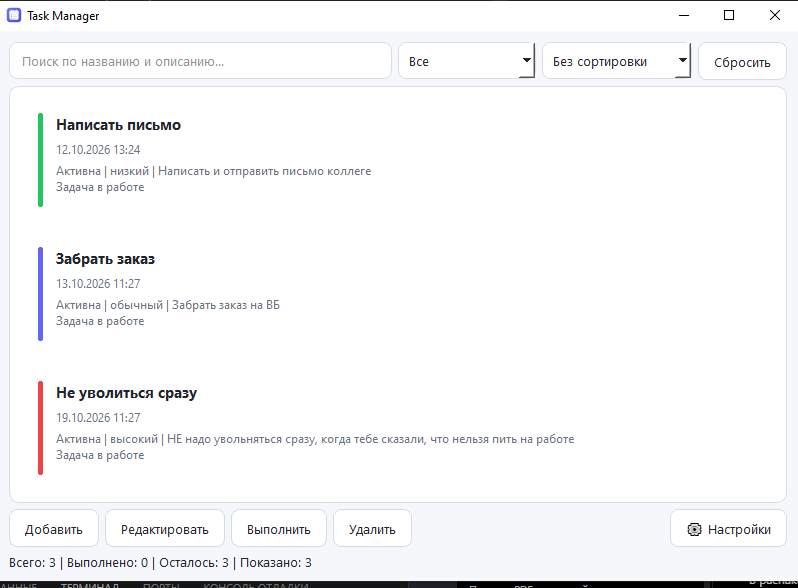

# Task Manager

[](https://isocpp.org/)
[](https://www.qt.io/)
[](https://cmake.org/)
[](https://www.microsoft.com/windows)

**Task Manager** — нативное desktop-приложение для Windows, реализованное на C++17 и Qt 6. Архитектура построена вокруг Qt Model/View: данные задач отделены от представления, фильтрация вынесена в proxy-модель, а визуальное отображение элементов реализовано собственным delegate.



## Технический обзор

- **Язык и стандарт:** C++17.
- **GUI-фреймворк:** Qt 6 (`Core`, `Gui`, `Widgets`).
- **Система сборки:** CMake 3.21+ с генератором Ninja.
- **Модель представления:** `QAbstractListModel`, `QSortFilterProxyModel` и `QStyledItemDelegate`.
- **Хранение задач:** JSON через `QJsonDocument`, `QJsonArray` и `QJsonObject`.
- **Настройки:** `QSettings`.
- **Событийная обработка:** сигналы/слоты Qt, `QTimer` и цикл событий `QApplication`.
- **Интеграция с Windows:** системный трей, значок приложения и установщик NSIS через CPack.
- **Развёртывание Qt:** `windeployqt` для копирования runtime-зависимостей в install-каталог.

## Архитектура

```text
┌──────────────────────────────┐
│          main.cpp            │
│ QApplication, ресурсы, QSS   │
└──────────────┬───────────────┘
               │
┌──────────────▼───────────────┐
│          MainWindow          │
│ Координация UI и действий    │
└───┬────────┬─────────┬───────┘
    │        │         │
    ▼        ▼         ▼
 TaskDialog TaskModel TaskStorage
 ввод       данные    JSON-файл
              │
              ▼
       TaskFilterProxyModel
       поиск и фильтрация
              │
              ▼
           QListView
              │
              ▼
         TaskDelegate
       отрисовка карточки

 MainWindow ── ReminderManager
            ├─ SettingsDialog / QSettings
            └─ QSystemTrayIcon
```

### Основные компоненты

| Компонент | Ответственность |
|---|---|
| `Task` | Тип данных задачи: идентификатор, название, описание, приоритет, срок и состояние выполнения. |
| `MainWindow` | Связывает UI, модель, хранилище, настройки, таймеры и системный трей. |
| `TaskModel` | Предоставляет данные Qt View через `QAbstractListModel`, роли и уведомления об изменениях. |
| `TaskFilterProxyModel` | Фильтрует и сортирует элементы, не дублируя основной список задач. |
| `TaskDelegate` | Отвечает за пользовательскую отрисовку карточек задач. |
| `TaskDialog` | Получает пользовательский ввод для создания и редактирования задачи. |
| `TaskStorage` | Преобразует задачи в JSON и выполняет загрузку/сохранение. |
| `ReminderManager` | Обрабатывает проверку условий напоминаний и сроков. |
| `SettingsDialog` | Предоставляет интерфейс настройки параметров приложения. |

## Поток данных

### От пользовательского ввода к представлению

```text
Пользователь
    ↓
TaskDialog
    ↓ getTask()
Объект Task
    ↓
MainWindow
    ↓ setTasks() / addTask() / updateTask()
TaskModel
    ↓
TaskFilterProxyModel
    ↓
QListView
    ↓ запрос ролей модели
TaskDelegate::paint()
```

### Персистентность

```text
QList<Task>
    ↓ TaskStorage::save()
JSON-сериализация
    ↓
QSaveFile / QFile
    ↓
tasks.json
```

При запуске обратный путь восстанавливает данные из JSON. Настройки интерфейса и приложения хранятся отдельно через `QSettings`; это разделяет пользовательские параметры и коллекцию задач.

## Qt Model/View и роли

`TaskModel` является источником данных для представления. Помимо стандартной роли `Qt::DisplayRole`, модель предоставляет специализированные роли:

- `TaskIdRole` — идентификатор задачи;
- `CompletedRole` — состояние выполнения;
- `PriorityRole` — приоритет;
- `DueDateRole` — срок выполнения;
- `OverdueRole` — вычисляемый статус просрочки.

Роли позволяют delegate и proxy-модели запрашивать типизированные свойства, не извлекая их из форматированной текстовой строки. Когда данные меняются, модель уведомляет представление сигналами Qt, в частности `dataChanged`, чтобы необходимые элементы могли быть перерисованы.

## Сроки и события

Qt использует событийную модель: после `QApplication::exec()` обработка пользовательского ввода, таймеров и перерисовки выполняется в event loop. Проверка временных условий может инициироваться `QTimer`; просрочка определяется сравнением срока задачи с текущим `QDateTime`, при этом завершённые задачи не должны считаться активной просрочкой.

## Сборка и развёртывание

### Требования

- Windows 10/11;
- Qt 6 с компонентами `Core`, `Gui`, `Widgets`;
- CMake 3.21 или новее;
- Ninja;
- совместимый компилятор C++17 (для указанной конфигурации — MinGW);
- NSIS — для создания установщика.

### Конфигурация

Пример для Qt 6.11.2 MinGW и Ninja:

```powershell
cmake -S . -B build -G Ninja `
  -DCMAKE_PREFIX_PATH="C:/Qt/6.11.2/mingw_64" `
  -DCMAKE_CXX_COMPILER="C:/Qt/Tools/mingw1310_64/bin/g++.exe" `
  -DCMAKE_RC_COMPILER="C:/Qt/Tools/mingw1310_64/bin/windres.exe"
```

### Сборка

```powershell
cmake --build build
```

### Установка в отдельный тестовый каталог

`windeployqt` запускается на этапе установки, чтобы скопировать Qt runtime-зависимости. Поэтому запуск одного `build/TaskManager.exe` без подготовленного runtime-каталога может завершиться ошибкой отсутствующей DLL.

```powershell
cmake --install build --prefix build/run
.\build\run\TaskManager.exe
```

### Создание установщика

После конфигурации и сборки CPack использует сгенерированную конфигурацию проекта:

```powershell
cpack --config .\build\CPackConfig.cmake -G NSIS
```

`CMakeLists.txt` описывает цель сборки, install-правила, развёртывание Qt и метаданные CPack/NSIS. Файлы внутри `build/` генерируются автоматически; редактировать их вручную не следует.

## Структура исходников

```text
src/
├── main.cpp
├── MainWindow.hpp / .cpp
├── Task.hpp
├── TaskModel.hpp / .cpp
├── TaskFilterProxyModel.hpp / .cpp
├── TaskDelegate.hpp / .cpp
├── TaskDialog.hpp / .cpp
├── TaskStorage.hpp / .cpp
├── ReminderManager.hpp / .cpp
├── SettingsDialog.hpp / .cpp
├── resources.qrc
├── app.rc
├── app.ico
└── app.svg

styles/
├── style.qss
└── dark.qss

cmake/
├── DeployQt.cmake
└── DeployQtInstall.cmake.in

docs/
└── screenshots/
```

## Инженерные решения

- **Разделение ответственности:** бизнес-данные, модель Qt, пользовательское представление и файловое хранение не смешаны в одном классе.
- **Слабая связанность представления и данных:** `TaskDelegate` работает через роли модели, а не через детали внутреннего контейнера.
- **Декларативная сборка:** CMake описывает цели, зависимости, установку и упаковку воспроизводимым способом.
- **Отдельный этап runtime-развёртывания:** наличие собранного `.exe` не означает, что рядом уже находятся все необходимые библиотеки Qt.
- **Ресурсы приложения:** `resources.qrc` включает статические ресурсы, доступные через Qt resource system (`:/...`).

## Документация по коду

- [`CODE_GUIDE.md`](CODE_GUIDE.md) — краткий справочник по терминологии и устройству проекта.
- Комментарии в исходниках объясняют назначение классов, методов и взаимодействие компонентов.

## Лицензия

Добавьте файл `LICENSE` с выбранной лицензией перед публичным распространением проекта.
