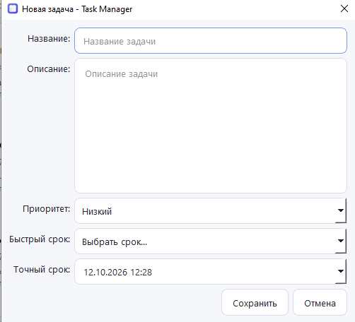
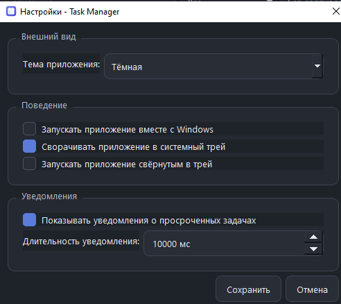

# DesktopApp / Task Manager — учебная версия с комментариями

Это та же структура проекта, но с расширенными комментариями для изучения C++/Qt.
Логика приложения намеренно не менялась: комментарии объясняют существующий код.

## Скриншоты приложения

Скриншоты помогают быстро понять, как выглядит программа, ещё до чтения исходного кода. Положите изображения в папку `docs/screenshots/` в корне проекта. Имена файлов должны совпадать с указанными ниже — тогда они автоматически отобразятся в этом README на GitHub и в других просмотрщиках Markdown, поддерживающих относительные пути.

### Главное окно


*На скриншоте желательно показать несколько задач с разными приоритетами и состояниями, а также поиск или фильтр, если они видны в интерфейсе.*

### Создание или редактирование задачи



*Откройте диалог добавления или редактирования задачи. Постарайтесь, чтобы были видны поля названия, срока, приоритета и остальные основные параметры.*

### Настройки приложения



*Покажите окно настроек. Если настройки помещаются в несколько вкладок, выберите наиболее информативную или сделайте отдельный дополнительный скриншот.*

> **Важно:** сами скриншоты в этот архив не включены, потому что в исходном архиве не было снимков работающего интерфейса. Добавьте три PNG-файла с указанными именами в `docs/screenshots/`. Если какой-то экран в вашей версии приложения отсутствует, удалите соответствующий блок или замените его снимком реально существующего экрана.

## 1. Как устроено приложение

Главная цепочка выглядит так:

```text
main.cpp
   │
   └── создаёт QApplication
          │
          └── MainWindow
                │
                ├── TaskDialog          ← ввод/редактирование
                ├── TaskModel           ← хранит задачи для Qt Model/View
                │      │
                │      └── TaskDelegate  ← рисует карточку
                │
                ├── TaskFilterProxyModel ← поиск/фильтр/сортировка
                │
                ├── TaskStorage         ← tasks.json
                │
                ├── ReminderManager     ← проверка сроков каждую секунду
                │
                ├── SettingsDialog      ← окно настроек
                └── QSystemTrayIcon     ← системный трей
```

## 2. Что происходит при запуске

1. `main.cpp` создаёт `QApplication`.
2. Задаёт имя организации и приложения — это важно для `QSettings` и `AppDataLocation`.
3. Если передан `--cleanup-data`, выполняется специальная очистка данных и приложение завершается.
4. Загружается базовый QSS.
5. Создаётся `MainWindow`.
6. `MainWindow` читает настройки, создаёт UI, загружает `tasks.json`, настраивает модель, трей и таймеры.
7. `application.exec()` запускает цикл событий Qt.

## 3. Что такое Qt event loop

После `application.exec()` программа в основном ждёт событий: кликов мыши, нажатий кнопок, сигналов, таймеров, перерисовки окон и т. д.
Поэтому `QTimer` может каждую секунду вызывать функцию без отдельного `while` в вашем коде.

## 4. Как одна задача проходит через программу

```text
TaskDialog
   ↓ getTask()
Task
   ↓
MainWindow::tasks
   ↓ setTasks()
TaskModel
   ↓
TaskFilterProxyModel
   ↓
QListView
   ↓ data()
TaskDelegate::paint()
```

При сохранении:

```text
MainWindow::tasks
   ↓
TaskStorage::save()
   ↓
QJsonArray / QJsonObject
   ↓
tasks.json
```

## 5. Почему нужны две модели

`TaskModel` — настоящие данные для Qt Model/View.
`TaskFilterProxyModel` — фильтр/сортировщик поверх неё.

Proxy-модель не создаёт независимую копию задач. Она ссылается на исходную модель и решает, какие строки показывать.

## 6. Почему OverdueRole обновляется каждую секунду

Просрочка зависит не только от содержимого `Task`, но и от текущего времени:

```cpp
task.dueDateTime < QDateTime::currentDateTime()
```

Значит, в 12:59 задача ещё активна, а в 13:00 уже просрочена, хотя объект `Task` физически не менялся. Поэтому `MainWindow` использует `overdueRefreshTimer`: каждую секунду вызывается `TaskModel::updateTask()`, который испускает `dataChanged()`. После этого Delegate заново получает `OverdueRole` и меняет внешний вид карточки.

## 7. Какие файлы реально входят в текущую сборку

Их список находится в `CMakeLists.txt`. В него входят:

- `main.cpp`
- `MainWindow.cpp/.hpp`
- `SettingsDialog.cpp/.hpp`
- `Task.hpp`
- `TaskDialog.cpp/.hpp`
- `TaskModel.cpp/.hpp`
- `TaskFilterProxyModel.cpp/.hpp`
- `TaskDelegate.cpp/.hpp`
- `ReminderManager.cpp/.hpp`
- `TaskStorage.cpp/.hpp`
- `resources.qrc`
- `app.rc`

### Файлы, которые сейчас НЕ используются executable

`TaskReminder.cpp/.hpp`, `UserData.cpp/.hpp`, `UserDialog.cpp/.hpp` отсутствуют в `qt6_add_executable()` и не участвуют в текущей сборке. Они похожи на остатки учебных/предыдущих вариантов.

Также `MainWindow::findTaskById()` объявлен и реализован, но в текущем коде не используется. Это не ошибка компиляции, а просто неиспользуемый вспомогательный метод.

## 8. Сборка и запуск

Для разработки:

```powershell
cmake -S . -B build -G Ninja `
    -DCMAKE_PREFIX_PATH="C:/Qt/6.11.2/mingw_64" `
    -DCMAKE_CXX_COMPILER="C:/Qt/Tools/mingw1310_64/bin/g++.exe" `
    -DCMAKE_RC_COMPILER="C:/Qt/Tools/mingw1310_64/bin/windres.exe"

cmake --build .\build
```

Сырой `build/TaskManager.exe` может не иметь рядом Qt DLL. Для локального запуска после установки зависимостей используйте:

```powershell
cmake --install .\build --prefix .\build\run
.\build\run\TaskManager.exe
```

## 9. Что делает CPack

`CPack` берёт результат `install()` и создаёт установщик NSIS. `DeployQt.cmake` подключает `windeployqt`, поэтому в устанавливаемую папку попадают Qt DLL и плагины.

## 10. Как читать проект по порядку

Если вы хотите разобраться самостоятельно, читайте именно так:

1. `Task.hpp` — какие данные вообще существуют.
2. `main.cpp` — откуда начинается программа.
3. `MainWindow.hpp` — какие части приложения связаны вместе.
4. `MainWindow.cpp` — что происходит при действиях пользователя.
5. `TaskModel.hpp/.cpp` — как Qt получает данные.
6. `TaskFilterProxyModel` — как работают поиск и фильтр.
7. `TaskDelegate` — как данные превращаются в красивую карточку.
8. `TaskDialog` — как пользователь создаёт/редактирует Task.
9. `TaskStorage` — как данные переживают перезапуск.
10. `ReminderManager` — как определяется момент просрочки.
11. `SettingsDialog` + `QSettings` — как сохраняются настройки.
12. `CMakeLists.txt` — как всё это собирается в Windows-приложение.

Главная идея: **не пытайтесь понять весь проект одновременно**. Сначала проследите одну задачу от `TaskDialog::getTask()` до `TaskStorage::save()`, а затем от `TaskModel::data()` до `TaskDelegate::paint()`.
